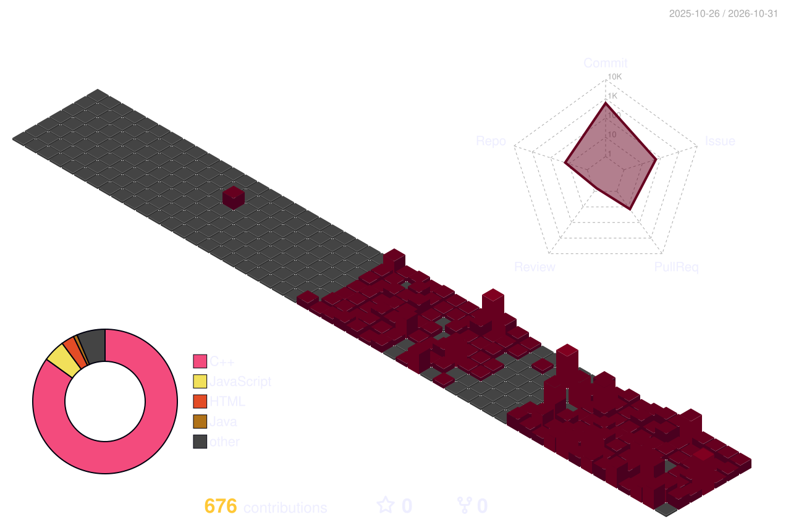

<!-- ============================================ -->
<!-- ANUSHKA SHARMA | LUXURY EDITORIAL README     -->
<!-- Burgundy: #561C24 | Cream: #E8D8C4           -->
<!-- ============================================ -->

 

<h3>Curiosity, translated into code.</h3>

  <em>Web Development · Artificial Intelligence · Continuous Learning</em>

---

### 01 / THE PERSON

# A little about me.

*Learning, experimenting, and turning curiosity into projects.*

- 🎓 B.Tech CSE student at JECRC University
- 💻 Currently learning full-stack development
- 🤖 Exploring artificial intelligence
- 🌱 Learning something new with every project
- 🇰🇷 Learning Korean
- 📖 I love journaling
- 📫 [Let's connect](mailto:annushkaa2604@gmail.com)

---

### 02 / PROOF OF WORK

# Things I'm building.

*Projects, experiments, and lessons learned along the way.*

<!-- PROJECT 01: Replace all placeholders with real details -->

<table>
<tr>
<td>

### 01 — [Your Project Name](YOUR_REPOSITORY_URL)

**THE PROBLEM**

What problem does your project solve, and who does it help?

**THE APPROACH**

Describe its most useful features and what you implemented.

**TECH STACK**

`Technology 1` · `Technology 2` · `Technology 3`

[View Source Code](YOUR_REPOSITORY_URL) · [Live Demo](YOUR_LIVE_DEMO_URL)

</td>
</tr>
</table>

<!-- PROJECT 02: Duplicate this card for another real project -->

<table>
<tr>
<td>

### 02 — [Your Second Project](YOUR_SECOND_REPOSITORY_URL)

**THE PROBLEM**

Explain the problem or idea behind this project.

**THE APPROACH**

Describe one or two meaningful features or technical decisions.

**TECH STACK**

`Technology 1` · `Technology 2`

[View Source Code](YOUR_SECOND_REPOSITORY_URL) · [Live Demo](YOUR_SECOND_LIVE_DEMO_URL)

</td>
</tr>
</table>

---

### 03 / THE TOOLKIT

# Tools of the trade.

*Technologies I'm learning and working with.*

 

---

### 04 / NOTES FROM THE BUILD LOG

# Small wins. Big lessons.

*Every project leaves me with something new to learn.*

<table>
<tr>
<td width="50%">

**FIELD NOTE 001**

`LEARNING`

**Subject:** Learning by building

**Status:** In progress

**Today's discovery**

Write about a concept you recently understood or a problem you're working through.

</td>
<td width="50%">

**FIELD NOTE 002**

`DEBUGGING`

**Subject:** A bug worth remembering

**Status:** In progress

**Today's discovery**

Describe what caused the issue, how you investigated it, and what you learned.

</td>
</tr>
</table>

> Keep these notes personal and factual. Update them as you make real progress.

---

### 05 / THE CONTRIBUTION GARDEN

# Consistency over perfection.

*Every contribution is a step forward.*

 

 

A living visualization of my GitHub contributions.

---

### 06 / THE PHILOSOPHY

 

# BUILT WITH CURIOSITY.

# IMPROVED ONE COMMIT AT A TIME.

 

*Open to learning, building, and collaborating.*

 

  

Learning. Building. Evolving.

